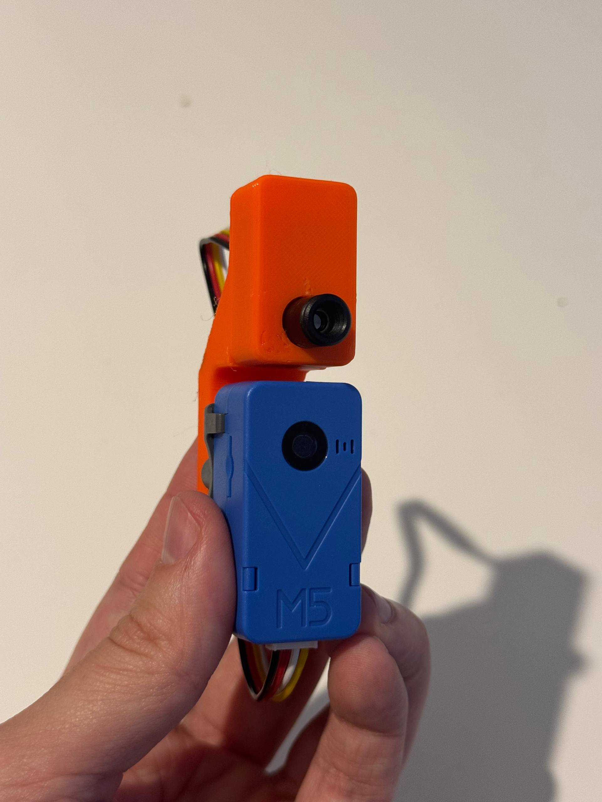
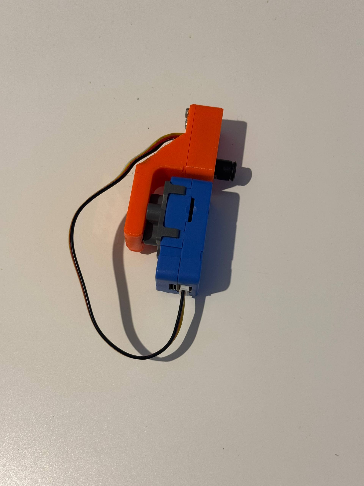
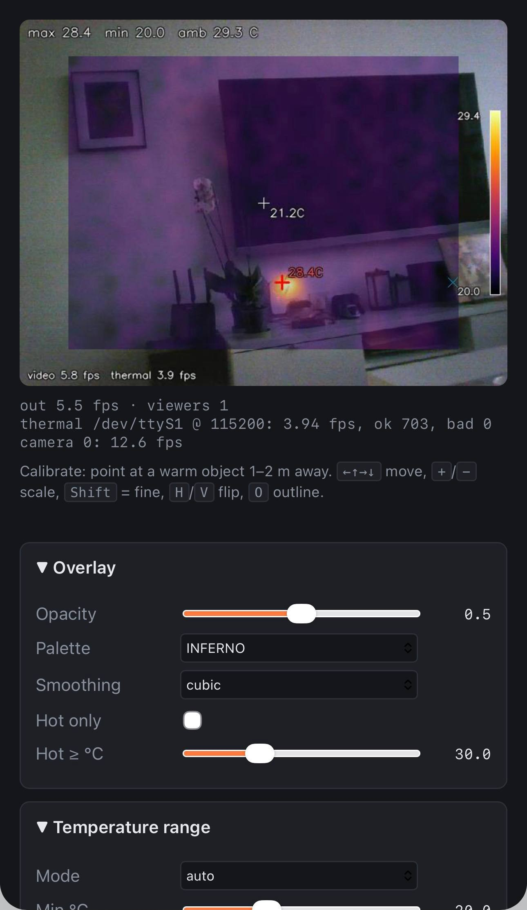
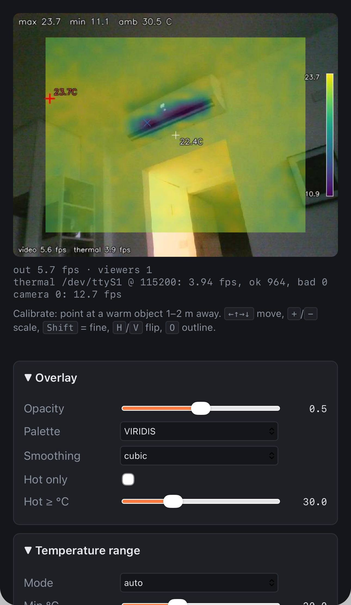

# UnitV2 thermal overlay

Live MLX90640 thermal image (via a GY-MCU90640 board) blended onto the M5Stack UnitV2
camera feed, streamed to a browser at `http://<unitv2>:8080`.

Everything runs on the UnitV2 with its stock Python 3 and OpenCV. The serial port is driven
through `termios` and the web server is `http.server`, so nothing needs `pip install` on the device.

<p>
  
  
  
  
</p>

## Opening it

| Connection | Address |
|---|---|
| Home WiFi | **http://&lt;unitv2-ip&gt;:8080**. Run `./deploy.sh pin-mac` once, then reserve an IP for that MAC on your router, so the address stays the same. |
| USB-C cable to a phone or computer | **http://10.254.239.1:8080** (see [Phone over USB](#phone-over-usb)) |
| The UnitV2's own WiFi hotspot | **http://10.254.239.1:8080** |

The overlay starts by itself about 30–40 s after power-on.

## Wiring

| UnitV2 Grove port | GY-MCU90640 |
|---|---|
| GND (black) | GND |
| 5V (red) | VCC (3.3–5 V) |
| TX | RX |
| RX | TX |

- **Logic levels:** both sides are 3.3 V, so no level shifter is needed.
- **TX/RX swapped?** If `./deploy.sh probe` receives 0 bytes, swap the two signal wires. That fixed it on this build.
- **Start command:** the server sends the "continuous output" command (`A5 35 02 DC`) every time it opens the port, so the module doesn't need to be preconfigured.

## Layout

```
thermal/mlx_uart.py        GY-MCU90640 protocol: frame parser, commands, background reader (auto baud fallback)
thermal/overlay.py         colourise + warp the thermal grid onto the frame, HUD
thermal/server.py          camera + render loop + MJPEG/HTTP server, crash-safe config
thermal/static/index.html  control page (sliders, keyboard calibration)
tools/uart_probe.py        bring-up tool: raw dump, baud scan, checksum check, send commands, loopback test
tools/overlay_ctl.sh       background start/stop with restart loop (used by deploy.sh and the boot script)
tools/root_setup.sh        root: device permissions, stop the stock app and Prusa cam
tools/autostart.sh         root: install/remove the boot script, disable/re-enable the stock app
tools/pin_mac.sh           root: fixed WiFi MAC (the RTL8188FU picks a random one each boot)
tools/usb_local.sh         root: no gateway/DNS for USB clients, so a plugged-in phone keeps its internet
tests/test_mlx_parse.py    parser + reader tests (run on the PC)
mount/                     CadQuery case model; generated STL/STEP in mount/out/
docs/images/               photos of the build and screenshots
docs/reference/            M5Stack UnitV2 drawings (U078-D), GY-MCU90640 board photo
deploy.sh                  everything on the device, over SSH (commands below)
```

## First-time setup

Each step is needed once per device and is safe to re-run. Steps marked *root* ask for the root password,
because `sudo` and `su` don't work on this firmware.

```bash
./deploy.sh connect             # type the m5stack password once (shared connection, 30 min)
./deploy.sh root-setup          # root: device permissions, stop the stock app + Prusa cam
./deploy.sh probe /dev/ttyS1 --start  # expect ~4 frames/s, valid checksums, room-temperature values
./deploy.sh pin-mac             # root: fixed WiFi MAC; reboot, then reserve its IP on the router
./deploy.sh autostart           # root: start the overlay at every boot instead of the stock M5 app
./deploy.sh usb-local           # root: phones on USB keep their internet
```

To undo:
- **Autostart:** `./deploy.sh autostart-off` brings the stock app back. Its boot script is renamed, not deleted.
- **`pin-mac` and `usb-local`:** run either one again with `off`.

If the UnitV2 is at a different address: `UNITV2_HOST=m5stack@<ip> ./deploy.sh …`.

## Day to day

| Command | |
|---|---|
| `./deploy.sh start` | push the code from this folder and restart the server |
| `./deploy.sh stop` | stop it (until the next `start` or reboot) |
| `./deploy.sh status`, `./deploy.sh log` | is it running, what is it saying |
| `./deploy.sh run` | stop the background server and run one in the foreground (debugging); `start` to go back |
| `./deploy.sh probe [dev] [args]` | serial bring-up tool on the device (`--scan`, `--start`, `--loopback`, …); `stop` first |
| `./deploy.sh info`, `./deploy.sh netinfo` | read-only device and WiFi reports |
| `./deploy.sh ssh`, `./deploy.sh disconnect` | shell; close the shared connection |

`push`, `start`, `run` and `probe` never overwrite the device's `config.json`. That file holds your calibration.

Test without hardware (on any machine with OpenCV):

```bash
python3 thermal/server.py --demo --no-camera --port 8080
python3 -m unittest discover -s tests -v
```

## Calibration

1. Point the unit at a warm object (hand, mug) 1–2 m away. Turn on **Outline** under Alignment.
2. If the hot spot moves the wrong way, toggle **Mirror H** / **Flip V** (`H` / `V` keys).
3. Use `+`/`−` to scale and the arrow keys to move until warm spots line up (hold `Shift` for fine steps).
4. Settings save to `thermal/config.json` on the device automatically.

Settings are saved crash-safe: the file is synced to flash, and the previous version is kept as `config.json.bak`.
A damaged file is set aside as `config.json.bad`, and the server falls back to the backup, then to the defaults.
Pulling the power right after a change can at most lose that one change.

Because of parallax (the sensor sits 23 mm above the camera), alignment is exact only at the distance you calibrated at.
The final scale also tells you which lens your sensor has:
- **about 0.8 of the frame width:** the 55°×35° (BAB) version. The default 0.8 already looked right on this build.
- **well over 1.0** (the overlay overflows the frame): the 110°×75° (BAA) version.

The **amb** value in the HUD is the module's own temperature, warmed by its electronics, not the room.

## Drawing: on the UnitV2 or in the browser

The switch under the video picks who draws the overlay. Each device remembers its own choice, and
`?draw=browser` / `?draw=server` in the URL sets it too.

| | **UnitV2** (default) | **This browser** |
|---|---|---|
| What is sent | one finished MJPEG stream (`/stream`) | the plain camera (`/camera`) + temperatures (`/api/thermal/stream`) |
| UnitV2 CPU | composites and re-encodes every frame (~5.5 fps) | passes camera JPEGs through, no compositing |
| Video rate | ~5.5 fps | up to **Max fps** (Display panel) |
| Works in | everything that shows MJPEG (Home Assistant, VLC, …) | browsers |

Both use the same settings, geometry and palettes (`/api/palettes` is generated from OpenCV's colour maps),
so they look the same. In browser mode, settings changes show instantly.

Camera pass-through needs OpenCV to hand out the camera's raw MJPEG frames. The stats line shows
`camera … (raw)` when it does. Otherwise it shows `(decoded)`, and frames are decoded and encoded once each,
which still saves the compositing. Raw frames from USB cameras usually lack JPEG Huffman tables. The server
adds the standard ones so browsers can decode them.

## Speed and delay

| | measured on this build |
|---|---|
| Camera | ~12.6 fps |
| Output stream (640×480) | ~5.5 fps, limited by the UnitV2's CPU (compositing + JPEG) |
| Thermal | 3.9 fps (4 Hz at 115200 baud) |
| Bandwidth | ~130 KB/s per viewer at JPEG quality 70 |

- **Stream delay:** the server keeps the stream's TCP send buffer to about one frame. If the link is slower than the
  stream, frames are skipped instead of queued, so the delay stays at about one frame's transfer time instead of growing
  to 10 seconds or more.
- **Weak WiFi:** lower **JPEG quality** to about 50 on the page. The RTL8188FU in the UnitV2 is weak: 58 KB/s across the
  room, 131 KB/s next to the router. USB is the most reliable link.

### Faster thermal frames

The module can send 8 Hz only at 460800 baud. 115200 carries at most about 4 frames/s.
The UnitV2's UART passes a loopback test at 460800, so it should work:
1. In the **Sensor** panel, press **→ 460800 baud**. This sends the baud command plus save.
2. **Unplug the UnitV2 for 5 s.** The module applies a new baud rate only after a power cycle.
3. Press **8 Hz**, then **Save to module**.

The reader looks for the module at the configured rate, then at 115200, 460800 and 9600, and follows it.
It never sends baud commands by itself. The page shows the rate in use (`thermal … @ <baud>`).

By hand: `./deploy.sh stop`, then `./deploy.sh probe /dev/ttyS1 --scan` finds the module's rate.
`./deploy.sh probe /dev/ttyS1 --baud <current> --set-baud 115200` saves a new rate (then power-cycle).

Command codes, from the GY-MCU90640 user manual V1.0:
- baud `A5 15 01/02/03` = 9600 / 115200 / 460800
- rate `A5 25 00…04` = 0.5 / 1 / 2 / 4 / 8 Hz
- `A5 35 01` query mode, `A5 35 02` automatic output
- `A5 65 01` save

While streaming at 9600 the module ignores commands. Send query mode first, as `--set-baud` does.

## Phone over USB

The UnitV2's USB-C port is a standard USB Ethernet device (SR9900 chip, CDC-ECM mode) with its own DHCP
server. Plug in a phone or computer with a USB-C cable and open **http://10.254.239.1:8080**.
- **Tested with:** an iPhone 15 Pro Max, where it appears under Settings → Ethernet, and Linux.
- **Power:** the phone powers the UnitV2.
- **Without a cable:** the UnitV2's own WiFi hotspot (`wlan1`, same 10.254.239.x network) gives the same address.

Out of the box, the UnitV2 tells USB clients it is their internet gateway, so an iPhone loses internet while plugged in.
`./deploy.sh usb-local` stops it from announcing a gateway and DNS. Re-plug the phone afterwards.

Tip: in Safari, Share → Add to Home Screen gives you a one-tap thermal camera icon.

## Case (3D print)

`mount/thermal_mount.py` is a parametric CadQuery model of a slim closed case on top of the UnitV2.
- **Size:** 20.8 mm wide, so narrower than the UnitV2.
- **Board:** mounted **upside down** and centred above the camera lens. The lens and sensor are 23 mm apart, all of it vertical.
- **Front:** only the sensor lens shows. The 9.3 mm lens assembly passes through a 9.7 mm hole.
- **Cooling:** a 3 mm air gap above the UnitV2's top vents.
- **Arm:** a 45° fin on the back cover carries a pin bar. It fixes to the back brick with **three LEGO Technic friction pins** in a vertical line.
- **Cable:** the Grove plug goes out through a slot in the cover above the fin. The cable then runs down the fin and the pin bar to the Grove port on the UnitV2's bottom.

```bash
pip install cadquery matplotlib
python3 mount/thermal_mount.py --render              # writes mount/out/: STL, STEP, previews, fit check
python3 mount/thermal_mount.py --set grove_slot_w=12 # override any parameter
```

| File | Use |
|---|---|
| `shell.stl` | Front, side, top and bottom walls. Print it front face down. |
| `lid_arm.stl` | Back cover with board bosses, locating rim, Grove slot, fin and pin bar. Print it on its side. |
| `pin_test.stl` | Hole-size coupon: nominal −0.1 / nominal / +0.1 mm (1 / 2 / 3 notches). With a 0.6 mm nozzle, PLA wanted 4.9 mm and PETG 5.0 mm. |
| `thermal_case.step` | Both parts, for editing in FreeCAD. |
| `thermal_case_assembly.step` | Both parts with simplified UnitV2, brick, board and pins. |

Print settings (0.6 mm nozzle): 3 perimeters, 30 % infill, **no supports**.
Technic pin holes: 4.9 mm for PLA (the default), 5.0 mm for PETG (`--set pin_hole_d=5.0`).
Heat-set inserts in PLA: about 200–220 °C, press slowly.

Hardware:
- 3 Technic pins.
- Heat-set inserts: 2 × M3×4×4.2 in the lid bosses, 2 × M3×6×4.2 in the shell's back face.
- Screws: 2 × M3×6 hold the board, driven from the sensor side; 2 × M3×8 close the case through the cover.

Assembly:
1. Melt in the inserts.
2. Solder the Grove cable to VIN/GND/RX/TX and push the plug out through the cover's slot.
3. Screw the board onto the bosses.
4. Slide the shell on from the front and screw it shut.
5. Press the pin bar onto the pins in the brick.

Because the board is upside down, start calibration with both **Mirror H** and **Flip V** on.

The model has been printed in PLA and assembled; everything fits.
Measured values: lens assembly 9.3 mm, board hole spacing 10 mm, can rim to hole centre 2.7 mm.
The parameters still marked `(measure)` in the script come from drawings and photos. The build proves they are close
enough, but check them if you use a different board or brick.

## HTTP API

| Endpoint | |
|---|---|
| `GET /` | control page |
| `GET /stream` | MJPEG stream with the overlay drawn by the UnitV2 |
| `GET /camera` | plain camera MJPEG (browser-side drawing), capped at `max_fps` |
| `GET /api/thermal/stream` | server-sent events, one per thermal frame: `{"seq", "amb", "age", "t": [768 × °C·100]}` |
| `GET /api/palettes` | the colour maps as `{name: [r, g, b, …] × 256}` |
| `GET /snapshot.jpg` | single JPEG |
| `GET /api/config`, `POST /api/config` | read / change settings (JSON) |
| `GET /api/stats` | fps, frame counters, errors, camera mode (`raw`/`decoded`), viewers per mode |
| `GET /api/thermal` | latest 24×32 temperature grid (°C) |
| `POST /api/mlx` | `{"rate": 4}`, `{"baud": 460800}`, `{"save": true}` |

## Device notes (stock firmware, checked 2026-11-02)

Software and ports:
- Python 3.8.6, OpenCV 3.4.9, numpy 1.16.4. Camera: UVC "USB Camera Mic" at `/dev/video0`.
- `ttyS0` is the Linux console; the Grove port is `ttyS1`.

Access and permissions:
- `sudo` and `su` are unusable (not setuid root). Root works only by SSH as `root@`.
- `/home/m5stack` isn't writable for `m5stack`, so SSH keys can't be installed. Use `./deploy.sh connect` to type the password once.
- Boot-order bug: `S100setup-priv` opens `/dev/null`, `/dev/tty*` and `/dev/video*` to all users, but it runs
  before `S81mdev`, which resets them to root-only. `./deploy.sh root-setup` renames it to `S82setup-priv`.

The stock app:
- It (`payload/server.py`, `server_core.py`, `bin/camera_stream`) holds the camera.
- Never stop it with `S85runpayload stop`: that runs `killall -9 python3`, which also kills the SoC overheat guard
  `/etc/thermal/check_thermal.py`. The scripts here match processes by command line instead.

WiFi:
- The RTL8188FU chip has no MAC in its efuse, so the `8188fu` driver picks a random MAC, and the router a
  new IP, at every boot.
- `./deploy.sh pin-mac [MAC]` makes `S10loadfsko` load the driver with `rtw_initmac=…`, and switches dhcpcd from a
  DUID to the MAC as client ID.
- USB networking: the SR9900 USB Ethernet chip, bridged with the hotspot (`br0`, 10.254.239.1/24).

No hardware video encoding:
- The SSD202D's encoder isn't reachable: no `/dev/mi*`, no `libmi_*` libraries, no vendor modules.
- `/usr/bin/ffmpeg` 4.2.4 has no libx264, and `h264_v4l2m2m` has no device behind it.
- Storage: 41 MB free of 410 MB flash. RAM: 116 MB.

Serial at boot:
- The server started at boot often reads nothing from `/dev/ttyS1` at 115200, while the module is streaming;
  any process started later reads it at once. The cause is unknown: no other reader, nothing in the kernel log.
- Workaround: if no thermal frame arrives within 30 s of starting, the server exits and `overlay_ctl.sh`
  starts a fresh one. That's at most 3 times per boot (`/tmp/thermal-overlay.restarts`).
- Every failed port open is logged with speed, bytes and frames (`./deploy.sh log`).
